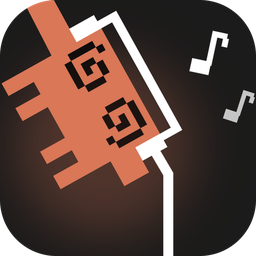
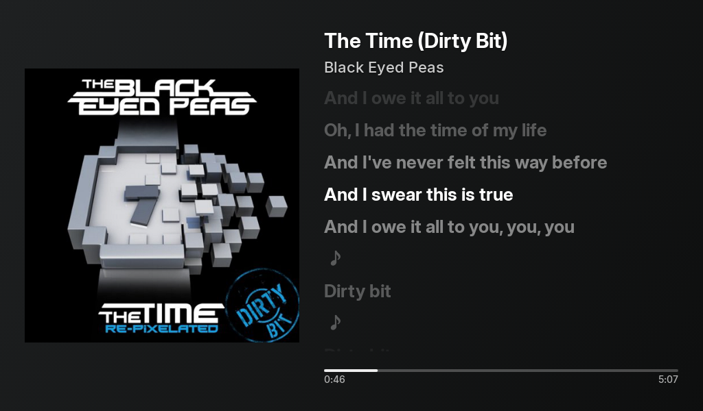
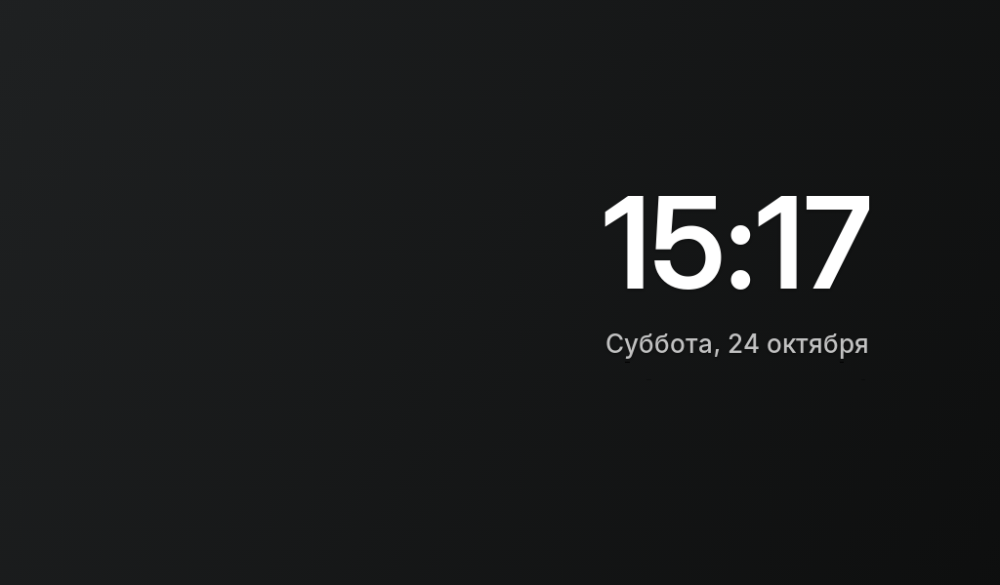
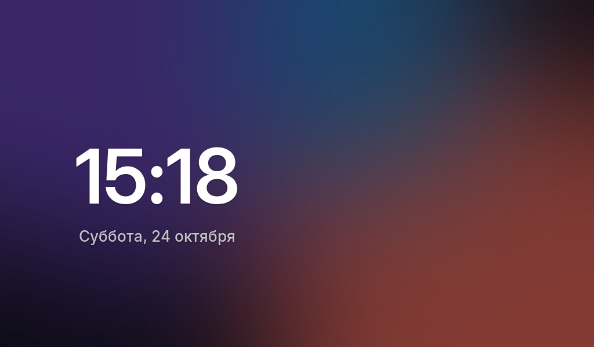

# NowPlaying — a "Now Playing" screen for an old tablet

**English** | [Русский](README.ru.md)

Turns an old Android tablet (tested on a Samsung Galaxy Tab 3 Lite, Android 4.2) into a display next to your computer. It shows whatever is playing on your Windows PC:

- cover art, title, artist and a progress bar;
- **synced lyrics** that highlight along with the music;
- a gradient background made from the cover's colors, or a looping video from the music video if Yandex Music has a video shot or a music video for the track;
- a big clock when nothing is playing.

<p align="center"></p>



| Clock when nothing is playing | Clock with a background (photo, GIF or video) |
|---|---|
|  |  |

*Screenshots taken on a Galaxy Tab 3 Lite (1024×600).*

Works with any player that shows up in the Windows media overlay (the "Now Playing" panel): Yandex Music, Spotify, music in a browser and so on. Clips shorter than 45 seconds, TikTok and YouTube Shorts are ignored.

```
Player on the PC ──► Windows media overlay ──► server on the PC ──Wi-Fi──► app on the tablet
                                                      │
                                    covers: iTunes, Deezer · lyrics: LRCLIB, Yandex Music · video: Yandex Music
```

> **Note:** the app and the tray program are in Russian. The guide below gives each Russian label with an English translation.

## Requirements

| | |
|---|---|
| **PC** | Windows 10 or 11. No need to install Python, it is built into the program |
| **Tablet** | Android 4.1 or newer, on the same Wi-Fi network as the PC |

## Installation

Download two files from the [latest release](../../releases/latest):

- `NowPlayingServer.exe` for the PC;
- `NowPlaying-1.5.1.apk` for the tablet.

### 1. Server on the PC

1. Put `NowPlayingServer.exe` somewhere permanent, for example `%LOCALAPPDATA%\NowPlaying\`. Autostart will point to this location.
2. Run it. No window opens; a ♫ icon appears in the system tray next to the clock.
3. On first launch the program:
   - **adds itself to Windows startup** (you can turn this off in the tray menu);
   - **asks for permission (a UAC prompt)** to open two firewall ports, for the local network only. Click "Yes", otherwise the tablet can't connect.

Windows SmartScreen may warn that the program is unrecognized, because it isn't signed with a developer certificate. Click "More info" → "Run anyway".

Tray menu (right-click the icon):

| Item | What it does |
|---|---|
| ▶ Artist — Song | what is playing now |
| Адрес для планшета (address for the tablet) | IP and port, if you need to enter it manually |
| Запускать вместе с Windows (start with Windows) | turn autostart on or off |
| Разрешить в брандмауэре… (allow in firewall…) | shown only if the ports are closed |
| Видео за треком (из Яндекс Музыки) (video behind the track) | on/off for the video background |
| Папка фона для часов… (clock background folder…) | opens the folder for the clock background |
| Открыть журнал (open log) | `%LOCALAPPDATA%\NowPlaying\server.log` |
| Обновить до … (update to …) | install a downloaded update now |
| Обновляться автоматически (update automatically) | on/off for automatic updates |
| Выход (exit) | stop the server |

### 2. App on the tablet

Copy `NowPlaying-1.5.1.apk` to the tablet and install it. You'll need to allow installs from unknown sources in the tablet settings.

Open the «Сейчас играет» ("Now Playing") app. It **finds the PC on its own** and starts showing your music. If it doesn't, long-press the screen and enter the address shown in the tray menu on the PC.

### Updates

Every 6 hours the server checks the [latest release](../../releases/latest) on GitHub. If there is a newer version, it downloads it, checks it against `SHA256SUMS.txt` from the same release, and installs itself once no music has been playing for 2 minutes (or right away from the tray menu). The new tablet app is downloaded by the server too and handed to the tablet over the local network, because Android 4.2 can't reach GitHub by itself. A rooted tablet installs it silently and restarts the app; otherwise the standard Android install dialog appears. Updates can be turned off in the tray menu.

## Tablet controls

| Gesture | Action |
|---|---|
| Tap | pause / resume |
| Swipe left | next track |
| Swipe right | previous track |
| Long press | enter the PC address manually |
| Drag up/down on the cover | PC volume |
| Drag up/down on the lyrics | scroll the lyrics; after 3 s they return to the current line |
| Tap a line while the lyrics are scrolled | jump to that line (synced lyrics only) |
| Drag or tap the progress bar | seek |

Other things the app does:

- **The screen stays on**, the app shows on top of the lock screen and **starts automatically** when the tablet boots.
- **When music is paused for more than a minute**, a clock appears. Once a minute it moves to a new spot to avoid screen burn-in.
- **Brightness adjusts itself**: with music it follows the system setting, at night (11 pm to 8 am) 10%; on the clock 15%, at night 2%. At night the clock and date turn dark red so they don't light up the room.
- **Video behind the track:** if the track has a video shot in Yandex Music (a short loop cut from the music video, mostly newer tracks) or, failing that, a music video (its 10-second preview is used: the full video needs a Yandex account), the server finds it through the public Yandex Music search, no account needed, and the tablet plays it blurred and dimmed behind the cover and lyrics. Other tracks keep the cover-tinted background. It can be turned off in the tray menu.
- **Clock background:** put a photo, GIF or video into the `Pictures\NowPlaying` folder on the PC (or open it from the tray menu). The newest file is used. The server prepares it for the tablet by itself: photos are downscaled, videos and GIFs are converted to MP4 up to 720p, without sound, up to 2 minutes. On the tablet the background fills the screen behind the clock, slightly dimmed; videos loop.
- **After 30 minutes without music** the screen goes black. A tap wakes it for a minute, new music wakes it right away.
- **If only plain lyrics were found** (no timings), the app shows «текст без синхронизации» ("lyrics not synced") under the artist.

## Running the server from source

You need Python 3.10+. In the `pc` folder:

```powershell
python -m venv .venv
.venv\Scripts\python -m pip install -r requirements.txt
.venv\Scripts\python nowplaying_app.py
```

`nowplaying_app.py` runs the server with the tray icon; `server.py` runs just the server in a console.

To build your own `NowPlayingServer.exe`, install PyInstaller (`.venv\Scripts\python -m pip install pyinstaller`) and run `sh pc/build_exe.sh` in Git Bash. The result goes to `release/`.

## Building the app

The app is built without Gradle or Android Studio, using `android/build.sh`. The script is meant for Windows and runs in Git Bash.

You'll need:

- **JDK 17**: `javac`, `jar` and `keytool` must be on the PATH.
- **Android SDK** with the `build-tools;34.0.0` and `platforms;android-17` packages. You can install them with `sdkmanager` from the Android command-line tools.

Set the SDK path in `ANDROID_SDK` or `ANDROID_HOME`. The path must not contain spaces or non-Latin characters: the Android tools break on them.

```bash
ANDROID_SDK=/c/android-sdk sh android/build.sh
```

The finished file appears at `android/NowPlaying.apk`.

On the first build a signing key, `nowplaying.keystore`, is created next to the SDK; you can point to a different one with `KEYSTORE`. **Keep this key**: without it a new version can't be installed over the old one, and you'd have to uninstall the app first. The key is never added to the repository.

## Troubleshooting

- **The tablet can't find the PC.** Check that the server icon is in the tray and that its menu doesn't show «Разрешить в брандмауэре…» (allow in firewall). Make sure the tablet and the PC are on the same network and the router doesn't isolate Wi-Fi clients from each other. You can also enter the address manually with a long press.
- **No lyrics.** Lyrics come from the open [LRCLIB](https://lrclib.net) database. Synced lyrics are used only if the track length matches (±4 s). If LRCLIB has nothing, plain lyrics (without timing) are taken from Yandex Music. Rare tracks may have no lyrics at all. Lyrics and video are looked up by artist and title, so they work the same for every player, Spotify and Apple Music included.
- **Blurry cover.** A small cover from Windows is shown first, then the server looks for a sharp one on iTunes (600 px) and Deezer (1000 px). The sharp one is used only if the title and at least one artist match.
- **Music doesn't show up.** Check whether the track appears in the Windows media overlay (the volume flyout in the tray). If it isn't there, the server can't see it either.

## For developers

The server (`pc/server.py`) is written in Python with aiohttp, winrt and Pillow. It keeps all data in memory only. The tray icon, autostart (a Task Scheduler "at log on" task, with the current user's `Run` registry key as a fallback) and firewall rules live in `pc/nowplaying_app.py`, built on pystray.

- **Ports:** TCP 47801 for HTTP, UDP 47800 for discovery. You can change them with `NP_HTTP_PORT` and `NP_UDP_PORT`.
- **HTTPS requests** are verified against the Windows certificate store (`truststore`).

| Request | Returns |
|---|---|
| `GET /api/now` | track, status, position, background color |
| `GET /art/<id>.jpg` | 480 px cover |
| `GET /api/lyrics/<id>` | synced lyrics `[{t, text}]` or plain lyrics |
| `GET /api/control/{toggle,next,prev}` | controls the current Windows player |
| `GET /api/control/seek/<ms>` | seeks the current track to that position |
| `GET /clip/<id>.mp4` | video for the track background (when `clip` in `/api/now` is set) |

The app (`android/`) is written in Java: minSdk 16, targetSdk 17, no third-party libraries. The font is [Inter 4.1](https://github.com/rsms/inter) (SIL Open Font License, `android/assets/fonts/LICENSE-Inter.txt`): Inter Display Bold for the title and lyrics, Inter Display SemiBold for the clock, Inter Medium for everything else. The files are subset to Latin and Cyrillic. It looks similar to SF Pro from Apple Music, whose license doesn't allow embedding it in Android apps.

## License

[MIT](LICENSE)

The icon is fan art of Clawd, the Claude Code character. The character belongs to Anthropic, and the MIT license does not cover it: it applies only to the project's code. This project is not affiliated with Anthropic.

`NowPlayingServer.exe` includes FFmpeg 7.1 from the [imageio-ffmpeg](https://github.com/imageio/imageio-ffmpeg) 0.6.0 package (an [imageio-binaries](https://github.com/imageio/imageio-binaries) build), used to prepare background videos. FFmpeg is distributed under the GNU GPL, not MIT. Source code: [ffmpeg-7.1.tar.xz](https://ffmpeg.org/releases/ffmpeg-7.1.tar.xz); see also [ffmpeg.org/legal.html](https://ffmpeg.org/legal.html).
